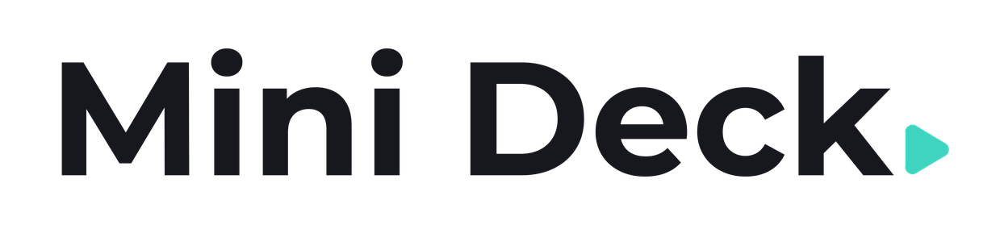
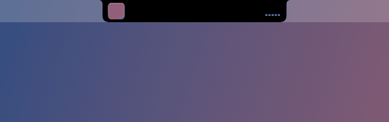
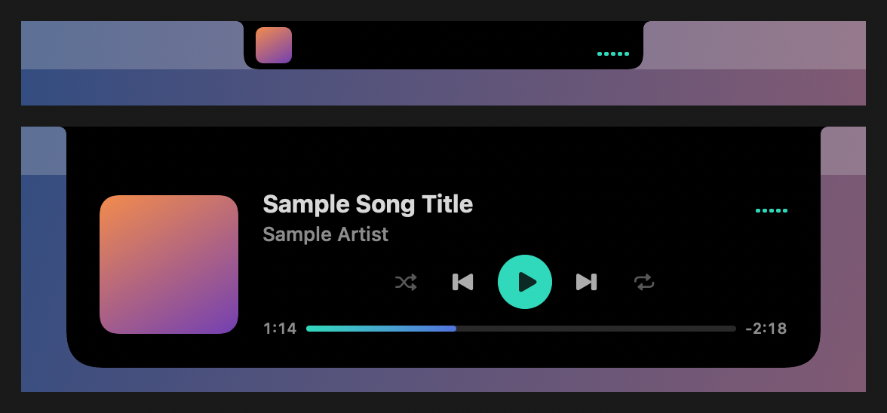

<p align="center">
  <picture>
    <source media="(prefers-color-scheme: dark)" srcset="Assets/readme/title-dark-mode.png">
    
  </picture>
</p>

<p align="center">A small floating music player for your Mac. Works with Spotify and Apple Music.</p>

<p align="center"><b><a href="https://github.com/michaeluretzky/mini-deck/releases/latest">Download the latest version</a></b><br>
Free for personal use · Apple silicon and Intel · macOS 14 or later</p>

<p align="center">
  
</p>

## Install in 30 seconds

1. Download `Mini-Deck-<version>.zip` from the [latest release](https://github.com/michaeluretzky/mini-deck/releases/latest) and double-click it.
2. Drag **Mini Deck** into **Applications**, then open it.
3. If macOS says it can't check the app, click **Done**, go to **System Settings > Privacy & Security**, and click **Open Anyway**. You only do this once.
4. Play a song in Spotify or Music. Click **Allow** when macOS asks if Mini Deck can control it.

That's it. Mini Deck lives in the menu bar and as a floating card.

<details>
<summary>More install options</summary>

If you're comfortable with Terminal, this also clears the first-launch block:

```sh
xattr -dr com.apple.quarantine "/Applications/Mini Deck.app"
```

To check the download, compare `shasum -a 256 Mini-Deck-<version>.zip` with the `.sha256` file on the release page.

To update by hand, quit Mini Deck, replace the app in Applications, and open it again. macOS may ask for permissions again.
</details>

## How to use it

- **Double-click** the player to switch between the full and compact views.
- **Drag** it anywhere. **Scroll** over it to change the volume. **Right-click** for more options.
- **Show in Notch** (menu bar icon): the player moves into the camera notch. Point at the notch to open it.
- **Listening History** (menu bar, or ⌘Y): your recent plays and top songs, artists and albums.

<p align="center">
  
</p>

### Keyboard shortcuts

These work from any app. Turn them off in menu bar > Keyboard Shortcuts.

| Shortcut | Action |
| --- | --- |
| ⌃⌥P | Play or pause |
| ⌃⌥] | Next track |
| ⌃⌥[ | Previous track |
| ⌃⌥M | Show or hide the player |

### Updates

Mini Deck checks GitHub about once a day for a new release and shows a message when one is out. Choose **Check for Updates…** in the menu bar to check now, or turn off **Check for Updates Automatically**. The check sends no personal data.

### Accessibility

Every button, the playback bar and the stat cards have VoiceOver labels. With VoiceOver, swipe up or down on the playback bar to move 10 seconds. When **Reduce Motion** is on in System Settings > Accessibility > Display, the player appears without the grow animation.

## Energy use

Mini Deck checks playback every second only while a song plays and the player is visible. When the player is hidden or the display sleeps, it checks every 4 seconds and keeps counting plays. Paused, it checks every 5 seconds (30 seconds when hidden). Low Power Mode halves the visible check rate and stops animations.

## Getting started

- **Apple Music:** nothing to set up. Play something in the Music app.
- **Spotify:** controls work right away with the Spotify desktop app. Your Spotify account stats are optional and need a one-time setup (see [Connect Spotify](#connect-spotify)).
- **Spotify account limit:** Spotify lets only 5 people connect to one developer app, and gives larger limits only to registered businesses ([Spotify quota modes](https://developer.spotify.com/documentation/web-api/concepts/quota-modes)). So most people create their own free Spotify developer app; Setup & Help walks you through it in a few minutes. Playback controls and stats from an imported Spotify export don't need this.
- Choose which app to follow from menu bar > Follow.

## Features

- Play, pause, skip, shuffle, repeat and seek from a small card that floats over your windows.
- Song, artist and album appear on separate icon-led rows, with extra spacing before the controls and playback bar.
- Responsive hover drawer: short opening delay, no competing resize animations, region-based hover updates, and a brief exit grace period to limit flicker.
- Scroll over the card to change the volume.
- The card's colors come from the album cover.
- Rest the pointer on the cover to see:
  1. **About this song & album:** short summaries, release year, song count, length, genre.
  2. **About the artist or band:** origin, years active or born, genres, short bio.
  3. **Your listening:** your own history with this song, this artist and this album (see below).
- **Listening History** window (menu bar > Listening History, or ⌘Y): your recent plays, top songs, top artists and top albums.
- Follows whichever app is playing, or one app you choose (menu bar > Follow).
- **Show in Notch** (menu bar > Show in Notch): the player moves into the camera notch, like the Dynamic Island. Closed, the cover and sound bars sit beside the notch. Point at it to open the player with its buttons and playback bar. Move the pointer away and it closes. On a screen without a notch, it sits at the top center of the screen. Turn the option off to bring back the floating card.

## Your listening stats

First launch includes an interactive **Setup & Help** guide with automatic checks, copy/paste helpers and a manual fallback. Playback and full-history import do not need a developer app. See [the complete setup guide](SETUP.md), including optional auto-import and distributor-configured sign-in.

Rest the pointer on the cover. Before an export is imported, **Your Spotify** shows artist and song rankings for one selected period (approximately 4 weeks, 6 months or 12 months), plus the current song's last timestamp found in returned recent history. These are Spotify affinity rankings, not measured play counts ([Spotify top items](https://developer.spotify.com/documentation/web-api/reference/get-users-top-artists-and-tracks)). Click **Show advanced** for detailed lists; Mini Deck remembers your choice.

The **Full history requested** reminder appears only after you mark the request yourself, in the card or Setup & Help. It is not a Spotify status check, has no countdown, can be cleared in Setup & Help, and does not appear by default for new users. **Import when ready** opens the local importer.

- **Spotify account:** account-wide top-song/artist ranks and recent plays, not device-local counts. The API supplies top lists and recent tracks, not lifetime totals ([top items](https://developer.spotify.com/documentation/web-api/reference/get-users-top-artists-and-tracks), [recently played](https://developer.spotify.com/documentation/web-api/reference/get-recently-played)).
- **Saved Spotify history:** imported music events plus new saved account records and observed Spotify playback. Overall plays include short listens; known listening time excludes API-only records whose duration is unavailable.
- **Apple Music:** library plays, last played, favorites and library rankings. These are Music library values, not a claim of complete cloud-account history.

| Source | Where the numbers come from | Setup |
| --- | --- | --- |
| Spotify account | Returned song/artist rankings for the selected period and up to 50 available recent records across devices, not complete history | Connect once (below) |
| Apple Music library | Play counts and last-played dates the Music app keeps for every song | None |
| Spotify history | Imported records plus ongoing saved account and Mac playback | Import files; keep Mini Deck running and connect Spotify for other devices |
| This Mac (history window only) | Plays and listening time Mini Deck counts while it runs, for both apps; never mixed into the main card | None. Can be turned off |

The **Listening History** window separates Spotify API rankings, combined saved Spotify history, Apple Music, and This Mac. API rankings are not play counts. The saved-history totals count deduplicated events, not affinity ranks; Apple Music library statistics remain separate.

The live display uses direct API rankings and recent timestamps, but this is not a claim of Spotify approval. Broader distribution and any derived-listening features require review against [Spotify's Developer Policy](https://developer.spotify.com/policy). Spotify branding is attributed in [Assets/NOTICE.txt](Assets/NOTICE.txt).

### Full-account history workaround

Spotify's **Extended streaming history** contains records from the lifetime of your account. The regular Account Data package only covers the past year ([Spotify's data guide](https://support.spotify.com/us/article/understanding-your-data/)).

1. In Spotify's **Download your data** tool, request **Extended streaming history**.
2. When Spotify provides the download, unzip it.
3. In Mini Deck choose **Listening Stats > Import Full Spotify History…**.
4. Select all relevant `Streaming_History_Audio*.json` or `endsong*.json` files, or their containing folder.

Import happens locally, without extra API calls. Mini Deck keeps only music names, Spotify track URIs, timestamps and milliseconds listened. It discards IP addresses, usernames, platforms, locations and private-session flags. Podcast/video rows and invalid records are skipped and counted in the import message. Exact duplicate events are ignored when importing overlapping files.

The card shows combined saved-history totals and their date range. Recording starts on first launch, not when an unopened download arrives. Mini Deck saves Spotify playback starts observed on this Mac, including short listens, and polls connected-account recent history at startup and about every two minutes. It attempts bounded paginated catch-up, preserves records across restarts, and deduplicates repeat API results. Local/API sessions are matched one-to-one by track and observed time interval; timestamp ambiguity can still affect matching.

An imported export is authoritative through its latest timestamp; only forward records after that cutoff are added. Importing a newer export replaces that covered part of the forward totals without deleting the private journal. Import all export files: a missing file or gap within the export range cannot be repaired by this cutoff rule. API-only records count as plays but do not invent listened duration from track length. The API supplies recent records and cursors, not a guaranteed lifetime archive ([Spotify recent history](https://developer.spotify.com/documentation/web-api/reference/get-recently-played)). Offline/closed-app gaps may remain, and the app does not claim complete synchronization. Keep Mini Deck running for collection; optionally enable Open at Login.

Ongoing history is stored privately as `spotify-live.json`, separately from the unchanged sanitized import. **Listening Stats > Clear Ongoing Spotify Records…** removes that journal without changing your import or Spotify account. Disabling Mac play counting also pauses local forward collection; account collection requires the optional Spotify connection.

The history window displays up to 100 rows per list, with totals computed across every imported music record. Imports accept extracted JSON files/folders, not ZIP archives; limits are 64 MB per file and 256 MB per batch. Import fewer files at a time if needed. Remove the sanitized copy with **Listening Stats > Remove Imported Spotify History…**.

### Historical song data

Historical song records are integrated into **Your Spotify** and **Listening History > Spotify > History**, without a separate source banner. Matching songs, artists and albums show **years in history**. The overall history combines recent account records, imported streaming history and year-level song records, deduplicating exact song IDs. Years are partial historical evidence, not exact listening dates, annual ranks, play counts or listening minutes.

Choose **Listening Stats > Import Historical Song Data…** to import a Mini Deck version-1 historical-song snapshot. Existing snapshot files remain compatible. This interchange format does not accept arbitrary account-summary files or screenshots. New installations contain no personal data. Files are parsed off the UI thread, bounded to 4 MB, sanitized, and saved locally with owner-only access. Reimporting replaces matching years; unreadable saved files are not overwritten. **Remove Historical Song Data…** deletes only Mini Deck's copy.

Historical song records never add synthetic events to full-history totals or alter Spotify's supplied affinity rankings. Private imports stay on this Mac when accounts change; remove them if they belong to a different account. No extra OAuth permissions are requested.

### Artist monthly listeners

The artist/band heading shows Spotify monthly listeners only when verifiable description metadata is returned by that artist's public Spotify page, with Spotify explicitly named. Exact or rounded values are retained as published. Successful results are cached in memory for six hours; missing results for 15 minutes. This is best-effort public-page data, not a supported Web API metric.

If Spotify serves a shell/login page or no audience metadata, the heading offers **Monthly listeners** as a link instead of inventing a count. Spotify's official artist API does not include monthly listeners ([artist reference](https://developer.spotify.com/documentation/web-api/reference/get-an-artist)). Apple Music's public artist attributes also do not include it ([Apple reference](https://developer.apple.com/documentation/applemusicapi/artists/attributes)); when available, an artist's Spotify count is labeled Spotify even during Apple Music playback. Followers and popularity scores are never presented as listener counts.

### Connect Spotify

Live Spotify stats are optional. A build with an appropriately configured distributor Client ID offers one-click OAuth; otherwise the interactive guide walks through your own developer registration. Development-mode restrictions still apply ([Spotify quota modes](https://developer.spotify.com/documentation/web-api/concepts/quota-modes)).

1. Sign in to the [Spotify Developer Dashboard](https://developer.spotify.com/dashboard) and create an app (any name and description).
2. Under **Redirect URIs**, add `http://127.0.0.1:8974/callback`.
3. Under **APIs used**, select **Web API**, then save.
4. Copy the **Client ID**.
5. In Mini Deck, choose menu bar > Listening Stats > Connect Spotify Account, paste the Client ID, and sign in.

Spotify's rules for developer apps: the app owner needs Spotify Premium, and sign-ins expire after 6 months. Mini Deck asks you to reconnect when that happens.

## Build from source

Needs macOS 14 or later and Apple's Command Line Tools (`xcode-select --install`). Xcode isn't needed.

```sh
git clone https://github.com/michaeluretzky/mini-deck.git
cd mini-deck
zsh make-app.zsh
open ~/Applications/"Mini Deck.app"
```

Run the script again after any code change. Because the app is signed only for this Mac, macOS may ask for permissions again after a rebuild. `zsh make-release.zsh` builds the same universal zip that's on the Releases page.

### Signed releases (for the maintainer)

The release workflow signs and notarizes the app when these repository secrets are set: `DEVELOPER_ID_P12_BASE64` (the Developer ID Application certificate, base64), `DEVELOPER_ID_P12_PASSWORD`, `DEVELOPER_ID_IDENTITY` (for example `Developer ID Application: Name (TEAMID)`), `NOTARY_APPLE_ID`, `NOTARY_TEAM_ID` and `NOTARY_APP_PASSWORD` (an app-specific password). A notarized app opens with a normal double-click, so step 3 of the install isn't needed. Without the secrets, releases keep the local signature.

## Permissions

- **Automation (Spotify, Music):** to read the current track and send commands.
- **Screen & System Audio Recording:** only for the sound bars. Without it, the bars use a placeholder animation.

See [SECURITY.md](SECURITY.md) for how data is handled.

## License

Free for personal, non-commercial use. You may download, build and use Mini Deck on your own Macs. You may not redistribute, sell or publish it or changed versions; please link to this page instead. See [LICENSE](LICENSE) for the full terms.

---

Spotify is a trademark of Spotify AB. Apple Music is a trademark of Apple Inc. Mini Deck isn't affiliated with or endorsed by either company.
